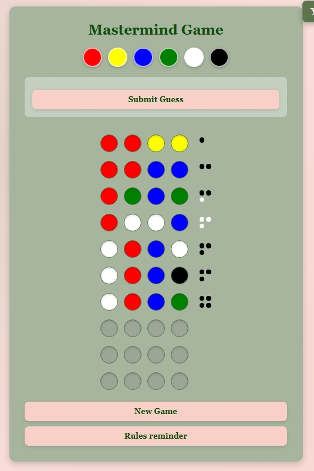
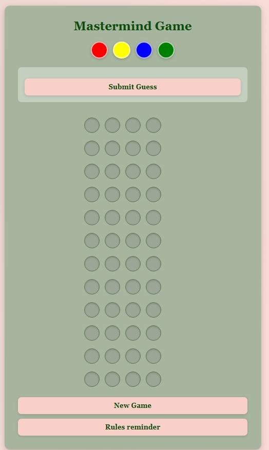
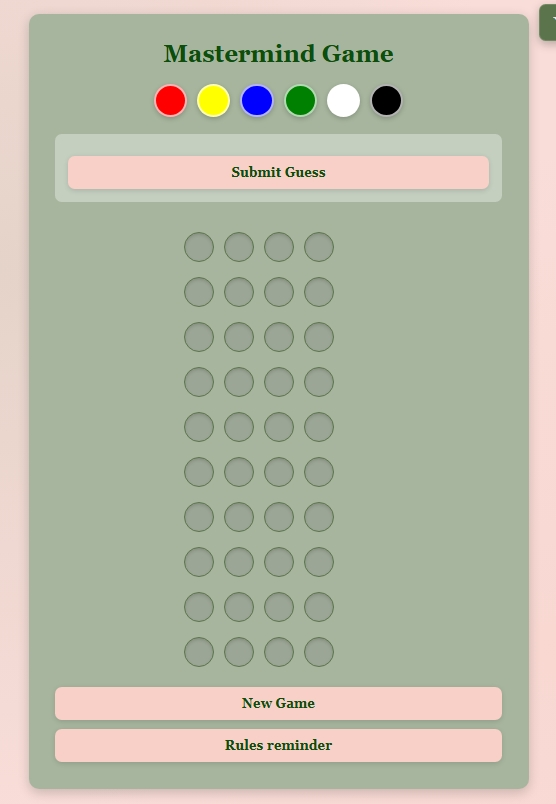
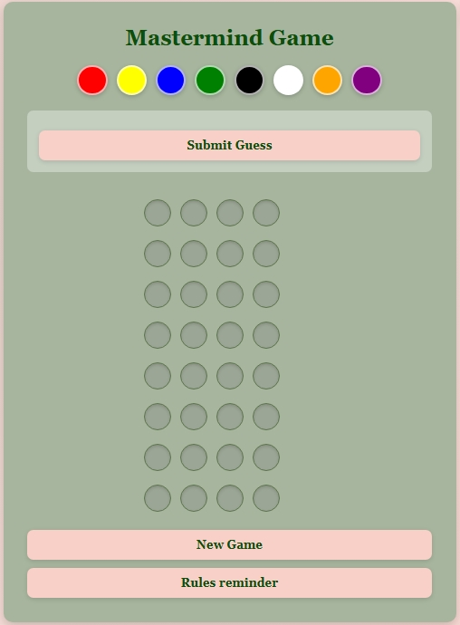

# MasterMind 


A FullStack web game — a REST API built with FastAPI connected to an HTML/CSS/JS frontend, with JWT authentication, a PostgreSQL database, and a full test suite.

[Play online](https://mastermind.jenny-dev.com)

**Tech Stack:** 

Backend: FastAPI, PostgreSQL, SQLAlchemy, JWT Auth

Frontend: HTML, CSS, JavaScript

Tools: Docker, Pytest, Git, Alembic

## Architecture

The project is organized into three layers:

- API (FastAPI): route handling and validation
- Business logic: pure functions in `game_logic.py`
- Data access: SQLAlchemy models (User → Game → Move)


## The game in a nutshell

Mastermind is a classic game where the goal is to guess a secret color combination.
The rules: the player must figure out which colors are in the combination and in what order. To do so, they test combinations and receive feedback after each attempt.


### Feedback tokens:
- White token → right color, wrong position
- Black token → right color, right position
- No token → nothing matches
- ⚫⚫⚫⚫ 4 black tokens → the player wins!

### Example of a winning game:


### Difficulty levels:
I decided to create 3 different difficulty levels:

| Level | Available colors | Maximum turns |
|--------|---------------------|---------------|
| Easy  | 4 | 12 |
| Medium  | 6 | 10 |
| Hard  | 8 | 8 |


| Easy game | Medium game | Hard game |
|----------------------|---------------------|--------------------------|
|  |  |  |

### Scoring system

The score depends on:
- the difficulty level (multiplier)
- the number of turns used

Formula:
(max_turns - turn_number + 1) × 10 × multiplier

Multipliers:
- easy ×1
- medium ×2
- hard ×3

## Features
- Secure sign-up and login (JWT)
- Create a game at the desired difficulty level (easy, medium, or hard)
- Play a move and get real-time feedback
- Score calculated at the end of each game (the harder and faster, the higher the score)
- Display of personal best score

## Why this project?
This is a learning project with three goals:
- Build a complete REST API
- Connect that API to a frontend
- Deploy the project

-------


## Installation:

### Prerequisites
- Python 3.11+
- Docker 

```bash
# Clone the repo
git clone https://github.com/jenny-sau/mastermind-api
cd mastermind-api

# Install dependencies
pip install -r requirements.txt

# Start the database
docker compose up -d

# Start the server
uvicorn main:app --reload
```

## Deployment

- **Backend**: deployed on [Railway](https://web-production-75841.up.railway.app/docs) with PostgreSQL
- **Frontend**: deployed on Netlify → [mastermind.jenny-dev.com](https://mastermind.jenny-dev.com)
- **Domain**: `mastermind.jenny-dev.com`


## API Routes

| Method  | Route | Description  |
|---------|-------|-------------|
| POST | `/auth/signup` | Create an account |
| POST | `/auth/login` | Log in  |
| POST | `/game/create` | Create a game |
| POST | `/game/{id}/move` | Play a move |
| GET | `/game/{id}` | Game state |
| GET | `/game/{id}/moves` | Move history |
| GET | `/games` | All my games |


### Possible future improvements
- Allow players to view their statistics
- Improved mobile support

## Tests
```bash
pytest
```
30 tests covering authentication, game routes, and business logic.

